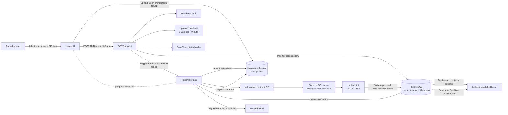

# DBTLint

**Upload a dbt project, lint its SQL in the background, and review project health from a web dashboard.**

[](LICENSE)


DBTLint is an open-source SaaS application for scanning ZIP archives of dbt projects. It runs `sqlfluff` against SQL files found under `models`, `tests`, and `macros`, then stores a score, issue counts, file-level violations, and recommendations for review.

<!-- TODO: add a product banner or demo GIF at public/screenshots/dbtlint-hero.png, then embed it here. -->

## Table of contents

- [Features](#features)
- [Architecture](#architecture)
- [Tech stack](#tech-stack)
- [Screenshots](#screenshots)
- [Getting started](#getting-started)
- [Scripts](#scripts)
- [Project structure](#project-structure)
- [Deployment](#deployment)
- [Contributing](#contributing)
- [Support](#support)
- [License](#license)

## Features

### Authentication

- ✅ Email and password registration and sign-in through Supabase Auth.
- ✅ GitHub and Google OAuth with a PKCE callback route.
- ✅ Session refresh and protection for dashboard routes.

### Linting pipeline

- ✅ Drag-and-drop, multi-file `.zip` uploads to the `dbt-uploads` Supabase Storage bucket.
- ✅ Background linting with Trigger.dev, live progress metadata, and database polling as a realtime fallback.
- ✅ `sqlfluff` 4.2.2 with the Jinja templater and Snowflake as the default dialect.
- ✅ Reports grouped into `models`, `tests`, and `macros`, with file paths, line positions, rule codes, errors, warnings, and a 0–100 score.
- ✅ Defensive archive handling, bounded sqlfluff concurrency, isolated subprocess environment, and cleanup of both temporary files and uploaded archives.

### Dashboard and reports

- ✅ Dashboard totals and 30-day comparisons for projects, scans, errors, and warnings.
- ✅ Recent scans, quick upload, latest scan per project, and per-project score history.
- ✅ Scan detail pages with score trends, category tabs, friendly rule explanations, and grouped recommendations.
- ✅ In-app completion notifications backed by the `notifications` table and Supabase Realtime.
- ✅ Scan-completion email delivery through Resend.

### Billing

- ✅ Free and Team plans persisted in PostgreSQL; Team checkout is currently priced at `$19/month` in the UI.
- ✅ Lemon Squeezy checkout, customer portal lookup, cancellation, signed webhooks, and subscription-state synchronization.
- ✅ Free-plan enforcement for one distinct project and five stored scan submissions. The current API counts all stored scans, while the billing usage endpoint displays scans from the current calendar month.
- ✅ Team users bypass the project and scan caps in `POST /api/lint`.

> The landing page also renders an Enterprise card and mentions CI/CD, collaboration, custom rules, SSO, audit logs, and on-premises deployment. Those capabilities are not implemented in the current codebase and are intentionally not listed as product features here.

### Observability

- ✅ Sentry instrumentation for client, server, edge, API, and task errors.
- ✅ Optional PostHog pageview analytics.
- ✅ Structured timing logs for lint API requests and Trigger.dev task phases.

## Architecture



### Processing contract

1. The browser sanitizes the filename, uploads the archive to `dbt-uploads`, and calls `POST /api/lint` with the original filename and returned storage path.
2. The API authenticates the user, checks that the storage path begins with the user's ID, applies a sliding-window limit of five uploads per minute, upserts the user, enforces plan limits, and inserts a `scans` row with `processing` status.
3. The API triggers the `dbt-lint` schema task and returns the scan ID, Trigger.dev run ID, and a read-only public token used for realtime progress.
4. The task downloads and validates the ZIP, ignores symlinks, quarantines project-controlled sqlfluff/dbt configuration, and applies its locked Jinja configuration.
5. SQL files are sent to `python -m sqlfluff lint --format json` in batches. `PRS*` and `TMP*` violations count as errors; all other violations count as warnings.
6. The scan becomes `passed` when it has no errors or `failed` when it has at least one error or encounters a user-facing validation failure. Results are stored as JSON in `scans.report`.
7. After sqlfluff finishes, completion work creates an in-app notification and dispatches a retryable email task. Storage and local temporary-file cleanup run from the task's `finally` path, including after validation or execution failures.

The score is calculated per file: `100 - (average errors × 15 + average warnings × 3)`, rounded and clamped to `0–100`.

### Pipeline limits and defaults

| Control | Current value |
| --- | ---: |
| Uploaded ZIP size | 50 MiB |
| ZIP entries | 10,000 |
| Declared uncompressed ZIP content | 300 MiB by default |
| Extracted project files | 5,000 |
| SQL files | 1,000 |
| Total SQL lines | 200,000 |
| Directory nesting | 20 levels |
| sqlfluff batch size | 40 files by default |
| sqlfluff batch concurrency per task | 1 by default |
| sqlfluff subprocess timeout | 60 seconds per batch |
| Trigger.dev task concurrency | 2 runs by default |
| Trigger.dev machine | `small-2x` |
| Trigger.dev task max duration | 3,600 seconds |

The uncompressed-size, batch-size, per-task sqlfluff concurrency, and task concurrency defaults can be overridden with environment variables documented below.

## Tech stack

| Area | Technology | Version in `package.json` |
| --- | --- | --- |
| Web application | Next.js App Router | `16.2.9` |
| UI runtime | React / React DOM | `19.2.4` |
| Language | TypeScript | `^5` |
| Styling | Tailwind CSS | `^4` |
| Components | Radix UI, Lucide, Framer Motion, Recharts, Sonner | See `package.json` |
| Authentication and storage | Supabase SSR / Supabase JS | `^0.12.0` / `^2.108.2` |
| Database | PostgreSQL, Drizzle ORM, Drizzle Kit | `^0.45.2` / `^0.31.10` |
| Background jobs | Trigger.dev SDK and React hooks | `4.5.3` |
| SQL linting | sqlfluff via Python | `4.2.2` |
| Rate limiting | Upstash Redis / Ratelimit | `^1.38.0` / `^2.0.8` |
| Billing | Lemon Squeezy SDK | `^4.0.0` |
| Email | Resend / React Email | `^6.17.1` / `^1.0.12` |
| Observability | Sentry / PostHog | `^10.63.0` / `^1.396.4` |
| Validation and forms | Zod, React Hook Form | `^4.4.3` / `^7.80.0` |
| Code quality | Biome | `2.2.0` |

## Screenshots

### Dashboard

<!-- TODO: add public/screenshots/dashboard.png and embed:  -->

_Overview cards, recent scans, plan usage, notifications, and quick upload._

### Upload flow

<!-- TODO: add public/screenshots/upload-flow.png and embed:  -->

_Multi-file queue with plan checks, Trigger.dev progress, and completion state._

### Scan detail

<!-- TODO: add public/screenshots/scan-detail.png and embed:  -->

_Score, trends, categorized violations, friendly explanations, and recommendations._

The existing `public/empty-projects.png` asset is used by the empty-projects state; the repository does not currently contain product screenshots or a marketing banner.

## Getting started

### 1. Prerequisites

- Node.js and npm compatible with Next.js 16.
- Python with `pip`; Trigger.dev installs `sqlfluff==4.2.2` from `requirement.txt` for deployed tasks.
- A PostgreSQL database and Supabase project.
- Upstash Redis, Trigger.dev, Lemon Squeezy, and Resend credentials for their respective features.

### 2. Install

```bash
git clone https://github.com/trungy-bui/dbtlint.git
cd dbtlint
npm install
pip install -r requirement.txt
```

### 3. Configure environment variables

Create `.env.local`. The checked-in `.env.local.example` currently contains a legacy app URL plus email and scan-callback placeholders; it is not a complete application configuration.

<details>
<summary><strong>Core application and Supabase</strong></summary>

| Variable | Required | Purpose |
| --- | --- | --- |
| `DATABASE_URL` | Yes | PostgreSQL connection string used by the app, Drizzle Kit, tasks, and database scripts. |
| `NEXT_PUBLIC_SITE_URL` | Yes | Public origin, such as `http://localhost:3000`, used by checkout redirects and scan-completion callbacks. |
| `NEXT_PUBLIC_SUPABASE_URL` | Yes | Supabase project URL. |
| `NEXT_PUBLIC_SUPABASE_PUBLISHABLE_KEY` | Yes | Browser/server publishable key used by Supabase Auth and Realtime clients. |
| `SUPABASE_SERVICE_ROLE_KEY` | Yes | Service-role key used by Trigger.dev tasks to download and delete uploaded ZIPs. Never expose it to the browser. |
| `UPSTASH_REDIS_REST_URL` | Yes | Read implicitly by `Redis.fromEnv()` for upload rate limiting. |
| `UPSTASH_REDIS_REST_TOKEN` | Yes | Read implicitly by `Redis.fromEnv()` for upload rate limiting. |

</details>

<details>
<summary><strong>Trigger.dev and lint worker</strong></summary>

| Variable | Required | Default / purpose |
| --- | --- | --- |
| `TRIGGER_SECRET_KEY` | Yes | Trigger.dev SDK/CLI authentication for the selected environment. |
| `NEXT_PUBLIC_TRIGGER_API_URL` | No | Trigger.dev API override used for a non-default or local Trigger.dev endpoint. |
| `SCAN_COMPLETE_WEBHOOK_SECRET` | Yes for email | Shared bearer secret between the lint task and `/api/scans/[scanId]/complete`. |
| `PYTHON_EXECUTABLE` | No | Preferred Python interpreter. An absolute path is accepted directly; otherwise it is validated. |
| `PYTHON_BIN_PATH` | No | Interpreter path supplied by the Trigger.dev Python extension. The task falls back to `python`, `python3`, and Windows `py -3`. |
| `DBT_LINT_MAX_TOTAL_UNCOMPRESSED_BYTES` | No | Maximum declared uncompressed ZIP bytes. Default: `314572800` (300 MiB). |
| `DBT_LINT_SQLFLUFF_BATCH_SIZE` | No | SQL files passed to each sqlfluff process. Default: `40`. |
| `DBT_LINT_SQLFLUFF_CONCURRENCY` | No | Concurrent sqlfluff batches within one task. Default: `1`. |
| `DBT_LINT_TASK_QUEUE_CONCURRENCY` | No | Concurrent `dbt-lint` task runs. Default: `2`. |

</details>

<details>
<summary><strong>Billing and email</strong></summary>

| Variable | Required | Purpose |
| --- | --- | --- |
| `LEMONSQUEEZY_API_KEY` | For billing | Lemon Squeezy API authentication. |
| `LEMONSQUEEZY_STORE_ID` | For billing | Store used to create Team checkouts. |
| `NEXT_PUBLIC_LEMONSQUEEZY_TEAM_VARIANT_ID` | For billing | Product variant used for Team checkouts. Despite the public prefix, it is currently read in a server route. |
| `LEMONSQUEEZY_WEBHOOK_SECRET` | For billing | HMAC-SHA256 secret used to verify the `x-signature` webhook header. |
| `RESEND_API_KEY` | For email | Resend API authentication. |
| `RESEND_FROM_EMAIL` | For email | Verified sender, for example `DBTLint <notifications@example.com>`. |

</details>

<details>
<summary><strong>Optional analytics and build configuration</strong></summary>

| Variable | Required | Purpose |
| --- | --- | --- |
| `NEXT_PUBLIC_POSTHOG_KEY` | No | Enables PostHog when set together with the host. |
| `NEXT_PUBLIC_POSTHOG_HOST` | No | PostHog API host. |
| `SENTRY_AUTH_TOKEN` | No | Allows the Sentry build plugin to upload source maps. Runtime DSNs are currently configured in the Sentry config files. |

</details>

`NEXT_PUBLIC_APP_URL`, which appears in the checked-in example file, is not referenced by the current application. Framework and operating-system variables such as `NODE_ENV`, `NEXT_RUNTIME`, `CI`, `PATH`, and locale variables are inherited at runtime and are not application setup keys.

### 4. Prepare Supabase and PostgreSQL

1. Create a private Supabase Storage bucket named `dbt-uploads` and configure authenticated users to upload within their own `<user-id>/...` prefix.
2. Apply the current Drizzle schema:

   ```bash
   npm run db:push:drizzle
   ```

3. Review and adapt `db/supabase-auth.sql`, then apply its Auth user-sync trigger and RLS statements through the Supabase SQL editor. The checked-in script still references a legacy `scans.date` index, while the current schema uses `scans.createdAt`; do not run the file unchanged against a fresh current schema.
4. Enable Supabase Realtime replication for `public.notifications` and add a SELECT RLS policy for `user_id = auth.uid()` if realtime completion notifications are required.
5. Enable email/password, GitHub, and Google in Supabase Auth, and register `/callback` for the local and deployed origins.

For migration-based workflows, generate and review a migration with `npm run db:generate`, then apply it with `npm run db:migrate`.

### 5. Start the application

```bash
npm run dev
```

This runs `next dev` and the Trigger.dev 4.5.3 development worker together. Open [http://localhost:3000](http://localhost:3000).

## Scripts

| Script | Command | Purpose |
| --- | --- | --- |
| `npm run dev` | `npx concurrently ... "next dev" "npm run trigger:dev"` | Run Next.js and Trigger.dev together. |
| `npm run build` | `next build` | Create a production Next.js build. |
| `npm run start` | `next start` | Serve the production build. |
| `npm run lint` | `biome check` | Check formatting and lint rules. |
| `npm run format` | `biome format --write` | Format supported files in place. |
| `npm run trigger:dev` | `npx trigger.dev@4.5.3 dev` | Run the Trigger.dev development worker. |
| `npm run db:generate` | `drizzle-kit generate` | Generate SQL migrations from schema changes. |
| `npm run db:migrate` | `drizzle-kit migrate` | Apply generated migrations. |
| `npm run db:push` | `node scripts/db-push-supabase.mjs` | Run the custom Supabase compatibility/bootstrap SQL script. |
| `npm run db:push:drizzle` | `drizzle-kit push` | Push `db/schema.ts` directly to the configured database. |
| `npm run db:studio` | `drizzle-kit studio` | Open Drizzle Studio. |

> `scripts/db-push-supabase.mjs` is older than the current Drizzle schema and does not create every current column or the `notifications` table. Prefer reviewed migrations for shared environments or `db:push:drizzle` for local setup.

## Project structure

```text
app/
  Next.js App Router pages and route handlers for landing, auth, dashboard,
  uploads, scans, projects, user plans, and Lemon Squeezy.
components/
  Landing, auth, dashboard, upload, project-report, and reusable UI components.
db/
  PostgreSQL client, Drizzle schema/migrations, and Supabase Auth/RLS SQL.
emails/
  React Email templates; scan completion is currently wired to Resend.
hooks/
  Shared React hooks.
lib/
  Auth, dashboard queries, billing, notifications, reports, plan limits,
  Supabase clients, validation, email, and shared utilities.
public/
  Static assets.
scripts/
  Database setup utilities.
trigger/
  Trigger.dev lint, scan-email, and uploaded-ZIP cleanup tasks.
```

The `rules`, `profile`, and `settings` page modules currently render empty placeholders; they are not documented as shipped features.

## Deployment

1. Deploy the Next.js application to a Next.js-compatible Node.js platform and configure the application, Supabase, Upstash, Lemon Squeezy, Resend, PostHog, and Sentry variables there.
2. Apply reviewed database migrations and the adapted Supabase Auth/RLS SQL, create the `dbt-uploads` bucket, and configure Auth callback URLs and Storage policies for the production origin.
3. Configure the Lemon Squeezy webhook endpoint as `https://<your-domain>/api/lemonsqueezy/webhooks` and subscribe it to the subscription events handled in the route.
4. Add task-side variables—at minimum the database, Supabase service role, site URL, and scan-completion secret—to the Trigger.dev environment.
5. Deploy the Trigger.dev tasks:

   ```bash
   npx trigger.dev@4.5.3 deploy
   ```

Trigger.dev uses the `node-22` runtime, installs `requirement.txt` through its Python build extension, and allows a maximum task duration of one hour. Scheduled tasks are not present in this repository.

## Contributing

Issues and pull requests are welcome. Before opening a pull request:

```bash
npm run lint
npm run build
```

Keep schema changes in `db/schema.ts`, generate and review the corresponding migration, and never commit `.env.local` or service-role credentials.

## Support

Use [GitHub Issues](https://github.com/trungy-bui/dbtlint/issues) for reproducible bugs and feature requests. Include relevant logs, the route or task involved, and sanitized environment details; never include tokens, uploaded project contents, or database credentials.

## License

DBTLint is available under the [MIT License](LICENSE).
